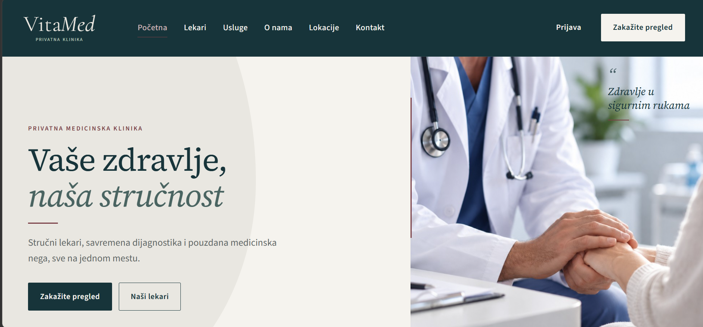
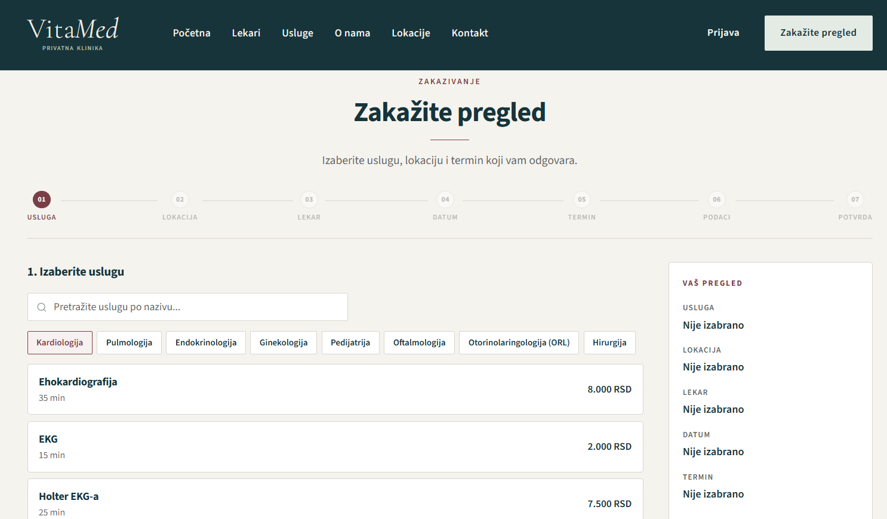
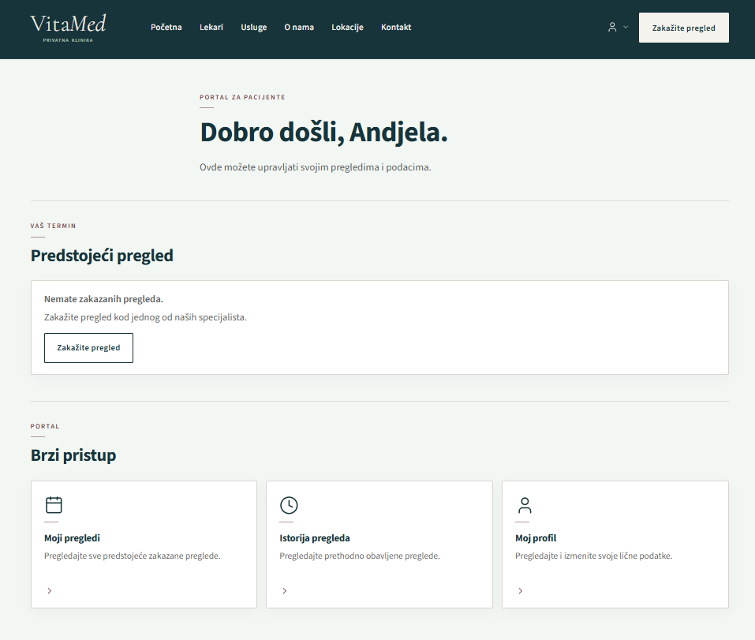
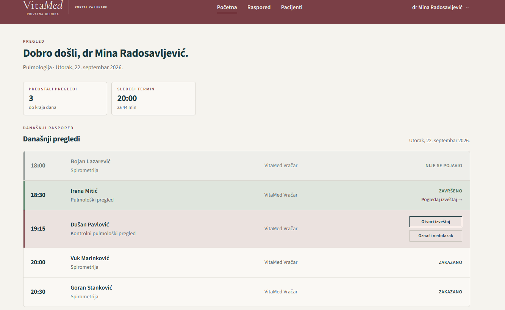
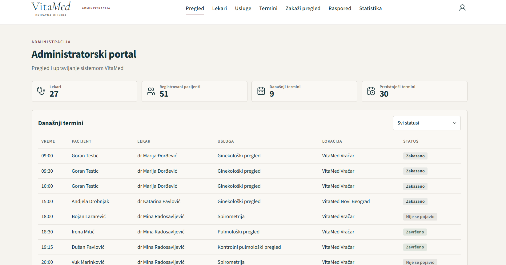
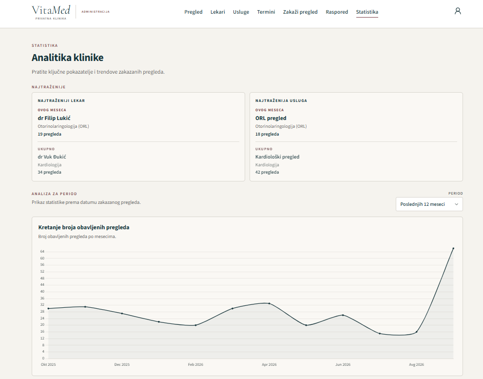

# VitaMed - Clinic Management Web Application

VitaMed is a full-stack web application developed as a bachelor's thesis project to support appointment scheduling and everyday operations in a private medical clinic. It brings together a public-facing website, a patient portal, a doctor portal, and an administration portal in one system.



## Tech Stack

| Layer | Technologies |
| --- | --- |
| Frontend | Angular, TypeScript |
| Backend | Node.js, Express, TypeScript |
| Database | MySQL |
| Authentication | JWT-based authentication |
| API | REST API |

## Key Features

### Public Website and Appointment Booking
- Browse medical specialties, doctors, services, and clinic locations.
- Book appointments through a guided, multi-step process.
- View available time slots based on the selected service, doctor, location, and date.
- Book as a guest or a registered patient.

### Patient Portal
- View upcoming appointments and appointment history.
- Cancel eligible appointments.
- Access reports from completed visits.
- Rate doctors after completed appointments.

### Doctor Portal
- View a daily appointment schedule and appointment statuses.
- Mark patient no-shows.
- Complete medical reports, including findings, diagnosis, and recommendations.

### Administration Portal
- Manage doctors, medical services, and appointments.
- Maintain doctors' working schedules, absences, and schedule exceptions.
- Book appointments on behalf of patients.
- View operational statistics, including appointment trends and popular services and doctors.

## Appointment Availability and Booking Logic

Appointment availability is calculated on the backend using the selected service duration, the doctor's working hours and assigned locations, schedule exceptions, absences, and existing bookings.

Before confirming an appointment, the backend checks availability again to reduce the risk of conflicting bookings. This keeps booking rules centralized rather than relying only on frontend validation.

## Application Screenshots

### Appointment Booking


### Patient Portal


### Doctor Portal


### Administration Dashboard


### Clinic Analytics


## Project Structure

```text
vitamed-clinic-management/
├── frontend/       # Angular application
├── backend/        # Express API, business logic, and database scripts
├── screenshots/    # Application screenshots
└── README.md
```

## Running Locally

**Prerequisites:** Node.js, npm, and MySQL.

1. Clone the repository and open it in your terminal.
2. Create and configure a local MySQL database using the SQL scripts in `backend/database/` (`schema.sql` and `seed.sql`).
3. In `backend/`, create a local `.env` file using `.env.example` as a template. Supply your own database credentials and other required configuration. **Do not commit `.env`.**
4. Install and start the backend:

   ```bash
   cd backend
   npm install
   npx tsc
   node dist/server.js
   ```

5. In a separate terminal, install and start the Angular frontend:

   ```bash
   cd frontend
   npm install
   npx ng serve
   ```

6. Open the local URL printed by the Angular development server.

> **Note:** The exact database setup and environment settings depend on your local configuration. No production credentials or real patient records are included in this repository.

## Project Context

VitaMed was developed as a bachelor's thesis project in Software Engineering at the University of Belgrade, School of Electrical Engineering.
